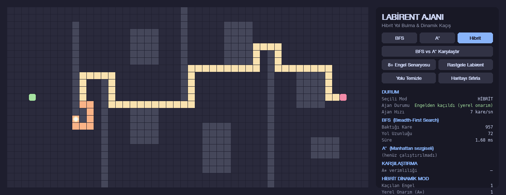
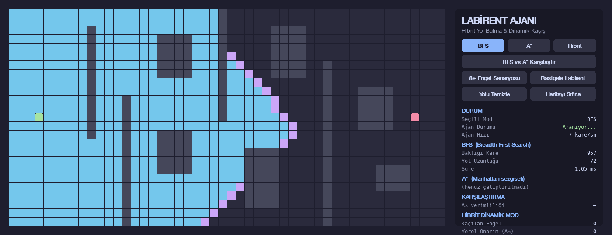
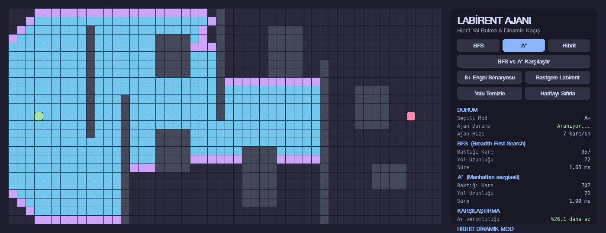
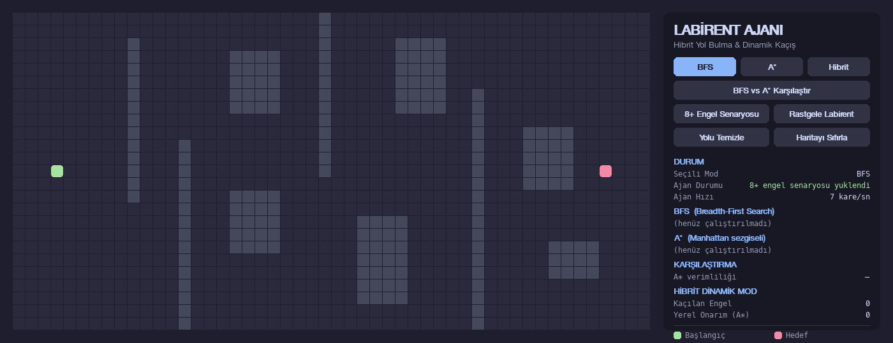

# 🧭 Labirent Ajanı — Hibrit Yol Bulma & Dinamik Engelden Kaçış

**Hybrid Pathfinding & Dynamic Obstacle Avoidance Visualizer**

Python + `pygame` ile geliştirilmiş, estetik **karanlık temalı (dark mode)**,
interaktif bir yol bulma görselleştiricisi. Bir ajan, labirentte başlangıçtan
hedefe giderken; kullanıcının **çalışma anında önüne koyduğu** engelleri fark
eder ve tüm haritayı yeniden taramak yerine **yerel bir onarım (local repair)**
ile engelin etrafından dolaşarak yoluna devam eder.

> 25 satır × 50 sütunluk grid · BFS · A* · Hibrit dinamik mod · canlı telemetri

---

## 📸 Ekran Görüntüleri

**Hibrit Dinamik Kaçış** — ajan (beyaz daire) rotasının önüne konan duvarı
fark edip turuncu yerel onarım (local repair) yamasıyla engelin etrafından
dolaşıyor:



| BFS — Dalga Yayılımı | A* — Yönlendirilmiş Arama |
|:---:|:---:|
|  |  |

**Genel görünüm** (8+ engel senaryosu yüklü):



---

## 🚀 Kurulum ve Çalıştırma

Python 3.9+ gereklidir.

```bash
# 1) (Önerilir) sanal ortam
python3 -m venv .venv
source .venv/bin/activate        # Windows: .venv\Scripts\activate

# 2) Bağımlılıkları yükle
pip install -r requirements.txt

# 3) Çalıştır
python main.py
```

---

## 🎮 Kontroller

### Fare
| Eylem | Sonuç |
|---|---|
| **Sol tık / sürükle** | Duvar (engel) ekle |
| **Sağ tık / sürükle** | Duvar sil |
| **Başlangıç / Hedef düğümünü tut-sürükle** | Düğümü taşı (ajan hareketsizken) |

### Klavye
| Tuş | Eylem |
|---|---|
| `1` | BFS çalıştır |
| `2` | A* çalıştır |
| `3` / `Boşluk` | Hibrit modu başlat / duraklat |
| `C` | Yolu temizle |
| `R` | Rastgele labirent |
| `P` | 8+ engel senaryosu |
| `+` / `-` | Ajan hızını artır / azalt |
| `ESC` | Çıkış |

### Butonlar (Yan Panel)
- **BFS / A* / Hibrit** — algoritma modunu seç ve çalıştır
- **BFS vs A* Karşılaştır** — iki algoritmayı aynı harita üzerinde kıyasla
- **8+ Engel Senaryosu** — hazır engel bloklu zorlayıcı harita
- **Rastgele Labirent** — çözülebilirliği garantili rastgele harita
- **Yolu Temizle** — animasyon/yol katmanlarını temizle (duvarları korur)
- **Haritayı Sıfırla** — her şeyi başa döndür

---

## 🧠 Algoritmalar

### Mod 1 — BFS (Breadth-First Search)
Ağırlıksız grid üzerinde **en kısa yolu garanti eder**. Arama dalgası
başlangıçtan her yöne eşit yayılır; bu yüzden hedefe göre "kör" ilerler ve
çok sayıda kareye bakar. Taranan kareler (**mavi**), sınır — frontier —
(**mor**) ve bulunan yol (**altın sarısı**) adım adım animasyonla çizilir.

### Mod 2 — A* (A-Star) _(Bonus)_
Her düğüm için `f = g + h` değerini kullanır:
- `g` = başlangıçtan o düğüme kadarki gerçek maliyet,
- `h` = **Manhattan mesafesi** sezgiseli (hedefe tahmini uzaklık).

Arama hedefe doğru yönlendirildiği için BFS ile **aynı uzunlukta** en kısa
yolu, genellikle **çok daha az kareye bakarak** bulur.

### Mod 3 — Hibrit Dinamik Mod (BFS Global Planner + A* Local Repair)
Gerçek robot/oyun navigasyonuna benzeyen iki katmanlı bir yaklaşım:

1. **Küresel planlama (Global Path):** Başlangıçta **BFS** ile başlangıçtan
   hedefe ana rota çıkarılır.
2. **Hareket:** Ajan bu rota üzerinde, ayarlanabilir bir hızla (vars. **7 kare/sn**)
   hedefe doğru adım adım ilerler.
3. **Dinamik engel:** Ajan hareket hâlindeyken kullanıcı, rotanın ilerisine
   fareyle yeni duvarlar ekleyebilir.
4. **Yerel onarım (Local Repair):** Ajan, önündeki rotanın bir duvarla
   kapandığını fark ettiği anda **tüm haritayı baştan taramaz**. Bunun yerine:
   - Engel kümesinin arkasında kalan **ilk açık ana-rota karesini** bulur,
   - Mevcut konumundan oraya kadar **yerel bir A*** çalıştırır,
   - Üretilen **turuncu yama (bypass)** yolu ana rotaya eklenir ve ajan yoluna
     devam eder.
5. **Yedek strateji:** Yerel yama mümkün değilse (engelin arkası da kapalıysa),
   mevcut konumdan hedefe **tam A*** çalıştırılır. O da yoksa durum
   _"Yol kapalı!"_ olarak bildirilir.
6. Her başarılı kaçış için **"Kaçılan Engel Sayısı"** ve **"Yerel Onarım Sayısı"**
   sayaçları artırılır.

**Neden yerel onarım?** Haritanın tamamını her engelde yeniden planlamak
pahalıdır. Yerel onarım, yalnızca engelin çevresindeki küçük bir bölgeyi
yeniden hesaplayarak ajanı anında ve ucuza yeni bir rotaya oturtur.

---

## 📊 Telemetri ve Karşılaştırma Paneli

Yan panelde canlı olarak gösterilir:

- **Seçili Mod** ve **Ajan Durumu**
- **BFS:** baktığı kare sayısı (visited), yol uzunluğu, süre (ms)
- **A*:** baktığı kare sayısı (visited), yol uzunluğu, süre (ms)
- **Verimlilik Farkı:** A*'ın BFS'ye göre yüzde kaç daha **az kareye** baktığı
- **Hibrit:** dinamik **Kaçılan Engel Sayısı** ve **Yerel Onarım (A*)** sayısı

### Örnek Sonuç Karşılaştırması (8+ Engel Senaryosu)

Preset harita üzerinde ölçülen **gerçek** değerler (medyan, 50 çalıştırma):

| Algoritma | Baktığı Kare (Visited) | Yol Uzunluğu | Süre |
|---|---:|---:|---:|
| **BFS** | 957 | 72 | ~1.64 ms |
| **A\*** | 707 | 72 | ~1.88 ms |
| **Verimlilik** | **%26.1 daha az kare** | aynı (optimal) | — |

A*, aynı uzunluktaki (72) en kısa yolu BFS'ye göre **%26.1 daha az kareye
bakarak** bulur. (Süreler makineye göre değişir; burada grid küçük olduğu için
mutlak süreler milisaniye mertebesindedir — asıl kazanım **bakılan kare
sayısında**dır.)

> Değerler harita düzenine göre değişir; "BFS vs A* Karşılaştır" butonuyla
> kendi haritanızda ölçebilirsiniz. İki algoritma **daima aynı uzunlukta** yol
> bulur (ikisi de en-kısa-yol optimaldir); fark **verimlilikte** (bakılan kare
> sayısında) ortaya çıkar.

---

## 🎨 Renk Paleti (Dark Theme)

Catppuccin Mocha esinli palet:

| Öğe | Renk | Kod |
|---|---|---|
| Arka plan (antrasit) | ⬛ | `#1E1E2E` |
| Boş hücre | ⬛ | `#2A2A3C` |
| Başlangıç | 🟩 | `#A6E3A1` |
| Hedef | 🟥 | `#F38BA8` |
| Duvar / Engel | ⬛ | `#45475A` |
| Taranan (Visited) | 🟦 | `#74C7EC` / `#89DCEB` |
| Sınır (Frontier) | 🟪 | `#CBA6F7` |
| En kısa yol | 🟨 | `#F9E2AF` |
| Yerel onarım (Repair) | 🟧 | `#FAB387` |
| Ajan | ⬜ | `#F5F5F5` (sarı halkalı) |

---

## 🗂️ Proje Yapısı

```
yzt-labirent-ajan/
├── main.py           # Uygulama, ana döngü, olay işleme, çizim ve hibrit ajan mantığı
├── grid.py           # Grid sınıfı, duvarlar, harita şablonları, çözülebilirlik kontrolü
├── algorithms.py     # BFS ve A* algoritmaları (animasyon + telemetri çıktısıyla)
├── ui.py             # Buton bileşeni ve yan panel / telemetri çizimi
├── config.py         # Boyutlar, yerleşim ve karanlık tema renk paleti
├── requirements.txt  # Bağımlılıklar (pygame)
├── .gitignore
└── README.md
```

Kod tamamı **Türkçe yorum satırlarıyla** açıklanmıştır ve yalnızca Pygame'in
yerleşik çizim/font araçlarını kullanır (harici font/görsel dosyası yoktur).

---

## 🔍 Nasıl Çalışır? (Kısa Teknik Özet)

- **Grid** `25×50` hücredir; duvarlar bir `set` içinde `(satır, sütun)` olarak
  tutulur, komşuluk 4 yönlüdür.
- **BFS** bir kuyruk (`deque`) ile katman katman yayılır; **A*** bir öncelik
  kuyruğu (`heapq`) ve Manhattan sezgiseliyle hedefe yönlenir.
- Animasyon, algoritmanın döndürdüğü `visited_order` (tarama sırası) listesinin
  kare kare açığa çıkarılmasıyla yapılır; **süre (ms)** ise algoritmanın gerçek
  hesaplama zamanıdır.
- Hibrit modda ajan her adımda kalan rotada duvar olup olmadığını denetler;
  engel bulursa `_repair()` yerel A*'ı çalıştırıp rotayı yamalar.
- Üretilen her rastgele/preset harita, BFS ile **çözülebilirlik açısından
  doğrulanır**.

---

## 💡 İpuçları

1. **P** ile 8+ engel senaryosunu yükleyin, **3** (veya Boşluk) ile hibrit modu
   başlatın; ajan ilerlerken rotasının **önüne** sol tıkla duvar çizin ve
   turuncu yerel onarımı izleyin.
2. Hız yüksekse `-` ile yavaşlatarak engel koymak için zaman kazanın.
3. Aynı harita üzerinde **"BFS vs A* Karşılaştır"** ile verimlilik farkını
   ölçün.
